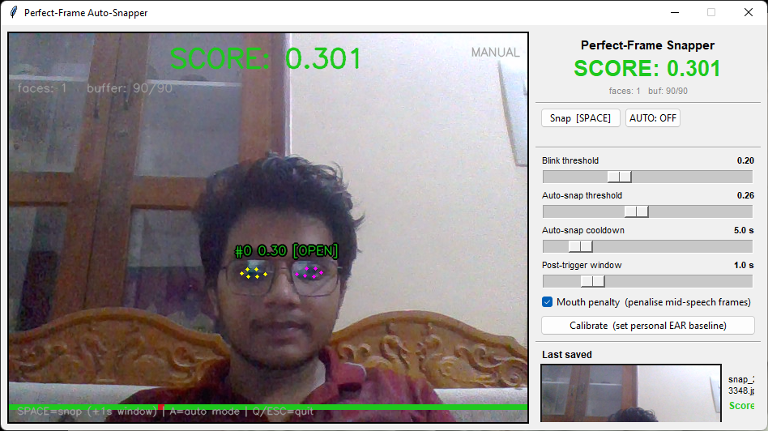
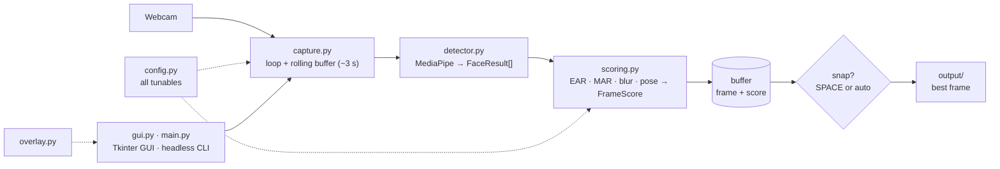
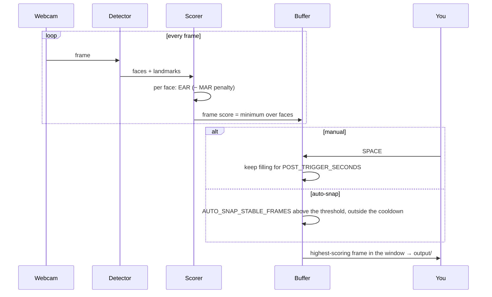

# Perfect-Frame Auto-Snapper

**Buffers the last few seconds of webcam footage and saves the one frame where everyone has their eyes open and nobody is mid-word.**

[](requirements.txt)
[](src/detector.py)
[](src/capture.py)
[](tests)
[](LICENSE)

No manual timing and no sifting through a burst of near-identical shots. Every
frame is scored as it arrives; when you press SPACE — or when auto-snap sees a
sustained good moment — the tool reaches back through its buffer and keeps the
best one.



---

## Contents

| Section | |
|---|---|
| [What it does](#what-it-does) | The feature surface, by area |
| [Architecture](#architecture) | Capture, detect, score, buffer, save |
| [How a snap happens](#how-a-snap-happens) | Manual and auto-snap |
| [Quick start](#quick-start) | Install, GUI, CLI, controls |
| [Configuration](#configuration) | The tunables, and the opt-in features |
| [Project status](#project-status) | Tests, evaluation, packaging |
| [Design decisions](#design-decisions) | The tradeoffs, and why |
| [Repository layout](#repository-layout) | Where things live |
| [Team](#team) | Who built it |

---

## What it does

| Area | Capabilities |
|---|---|
| **Face scoring** | MediaPipe's 478-point Face Landmarker on every frame |
| **Blink detection** | Eye Aspect Ratio (EAR), with an optional Mouth Aspect Ratio (MAR) penalty for mid-speech frames |
| **Manual mode** | SPACE reaches back through the buffer, with an optional post-trigger window |
| **Auto-snap** | Saves the instant it sees a sustained run of high-quality frames, with a cooldown |
| **Calibration** | Measures your resting EAR for a personal blink threshold |
| **Composite scoring** | Blur and head pose blended with eye/mouth (opt-in) |
| **Face weighting** | Weights each face by size and centring for group shots (opt-in) |
| **Adaptive learning** | Keep/Discard feedback nudges the auto-snap threshold over time (opt-in) |
| **Interfaces** | A Tkinter GUI with live sliders, and a headless CLI |

---

## Architecture



---

## How a snap happens



The frame's score is the **minimum across faces**: one blinker tanks the whole
frame.

---

## Quick start

```bash
# 1 — environment
python -m venv venv
venv\Scripts\activate              # Windows · source venv/bin/activate on macOS/Linux
pip install -r requirements.txt

# 2 — the GUI (recommended), or the headless CLI
python run.py
python -m src.main
python -m src.main --calibrate     # personal blink threshold → calibration.json
```

The Face Landmarker model (~10 MB) downloads to `models/` on first run and is
cached after that.

| Key | Action |
|---|---|
| **SPACE** | Fire a manual snap |
| **A** | Toggle auto-snap |
| **Q** / **ESC** | Quit and print a session summary |

The GUI mirrors these with buttons, live sliders for every threshold, a
Calibrate button and a thumbnail of the last saved shot.

---

## Configuration

All tunables live in [`src/config.py`](src/config.py); GUI sliders change the
same values for the session.

| Constant | Default | What it does |
|---|---|---|
| `CAMERA_INDEX` | `0` | Webcam index |
| `BUFFER_SIZE` | `90` | Rolling buffer in frames (~3 s at 30 fps) |
| `BLINK_THRESHOLD` | `0.20` | EAR below this counts as a blink |
| `ENABLE_MOUTH_PENALTY` | `True` | Penalise wide-open mouths |
| `POST_TRIGGER_SECONDS` | `1.0` | Extra buffering after SPACE (`0` = pure pre-trigger) |
| `AUTO_SNAP_THRESHOLD` | `0.26` | Minimum score for an auto-snap candidate |
| `AUTO_SNAP_STABLE_FRAMES` | `8` | Consecutive good frames before firing |
| `AUTO_SNAP_COOLDOWN` | `5.0` | Seconds between auto-snaps |

| Opt-in feature (default off) | Enable via |
|---|---|
| Composite scoring | `USE_COMPOSITE_SCORING = True` |
| Adaptive learning | `ENABLE_ADAPTIVE_LEARNING = True` |
| Face weighting | `USE_FACE_WEIGHTING = True` |
| Adaptive calibration | `--calibrate` or the GUI button |

---

## Project status

Complete for its scope: 67 tests pass, and a benchmark measures how closely the
chosen frame matches human labels.

| Suite | Needs a webcam |
|---|:---:|
| `test_scoring.py` · `test_main.py` · `test_detector.py` | no |
| `test_calibration.py` · `test_composite_scoring.py` · `test_feedback.py` | no |
| `test_webcam.py` (integration) | yes |

[`tests/evaluate.py`](tests/evaluate.py) compares the algorithm's pick against a
human-labelled best frame across recorded clips; the dataset format is in
[tests/eval_data/README.md](tests/eval_data/README.md).

**Packaging.** PyInstaller builds a standalone binary (typically 200–400 MB with
MediaPipe and OpenCV):

```bash
pip install pyinstaller
pyinstaller --onefile --windowed \
  --add-data "models/face_landmarker.task;models" \
  --hidden-import mediapipe --hidden-import PIL._tkinter_finder run.py
```

---

## Design decisions

**Retroactive, not predictive.** Instead of guessing when to fire, keep the last
few seconds and choose afterwards. The post-trigger window catches the moment
just after you press.

**Minimum, not average.** A group photo is only as good as its worst face, so
the frame score is the minimum across faces — unless face weighting is turned on
for crowds with small background faces.

**Stable runs for auto-snap.** One good frame is noise; a run of
`AUTO_SNAP_STABLE_FRAMES` above the threshold is a moment. A cooldown stops
near-duplicate saves.

**Everything advanced is opt-in.** Composite scoring, face weighting and
adaptive learning change behaviour in ways a user should choose, so the default
is the simple, explainable EAR/MAR score.

**One config, two interfaces.** The GUI and CLI share `config.py`, so a value
tuned live in the GUI can be made permanent in one place.

---

## Repository layout

```
.
├── src/
│   ├── config.py      all tunables
│   ├── capture.py     webcam loop + rolling frame buffer
│   ├── detector.py    MediaPipe wrapper → FaceResult[]
│   ├── scoring.py     EAR / MAR / blur / pose → FrameScore
│   ├── overlay.py     OpenCV drawing helpers
│   ├── main.py        headless CLI
│   └── gui.py         Tkinter GUI
├── tests/             unit, feature and webcam tests, evaluate.py, eval_data/
├── output/            saved frames
└── run.py             GUI entry point
```

---

## Team

| Member | Focus |
|---|---|
| **Guru R Bharadwaj** | Scoring, buffering, auto-snap, GUI and evaluation |

---

## License

[MIT](LICENSE).
